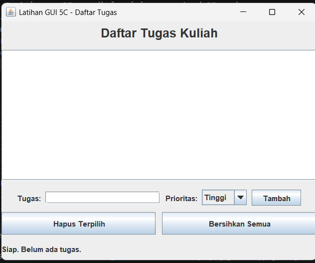
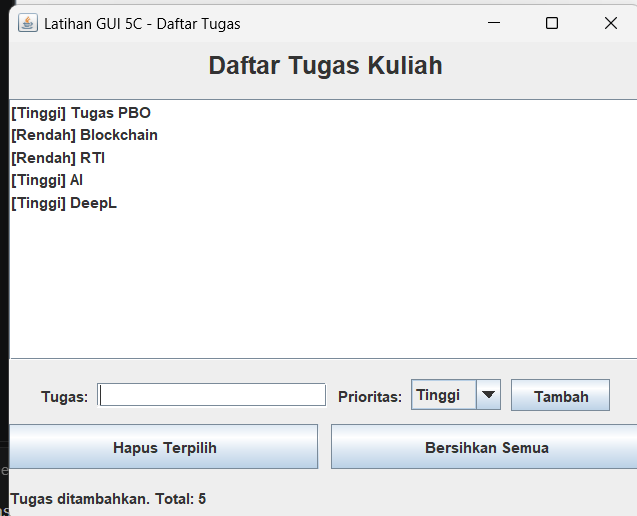
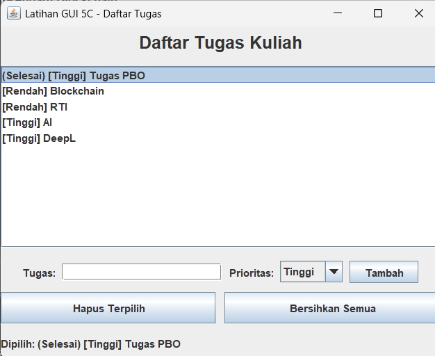
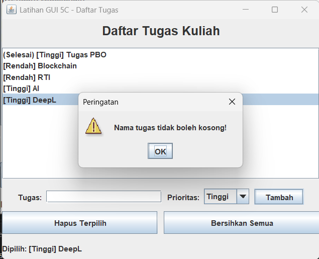

# Latihan GUI 5C - Aplikasi Daftar Tugas Kuliah

**Nama :** Rendy Wahyu Islami
**NIM  :** F1D02410133

Aplikasi GUI sederhana berbasis **Java Swing** untuk mencatat tugas kuliah beserta prioritasnya. Tugas bisa ditambah, dihapus, dan ditandai selesai.

## Cara Menjalankan

```bash
javac App.java
java App
```

Membutuhkan JDK 8 atau lebih baru.

## Fitur

- Menambah tugas dengan prioritas (Tinggi / Sedang / Rendah)
- Menekan tombol **Tambah** atau tombol **Enter** pada kolom input
- Menghapus tugas yang dipilih
- Menghapus semua tugas (dengan dialog konfirmasi)
- **Klik 2x** pada tugas untuk menandainya selesai / membatalkan
- Label status yang berubah sesuai aksi pengguna

## Komponen yang Digunakan

### 1. Top Level Container

| Komponen | Keterangan |
|---|---|
| `JFrame` | Jendela utama aplikasi. Kelas `App` meng-extend `JFrame`. Dipakai untuk mengatur judul, ukuran, posisi, dan operasi saat ditutup. |

### 2. Intermediate Component

| Komponen | Keterangan |
|---|---|
| `JPanel` (panelJudul) | Wadah judul aplikasi |
| `JPanel` (panelInput) | Wadah label, textfield, combobox, dan tombol Tambah |
| `JPanel` (panelTombol) | Wadah tombol Hapus dan Bersihkan |
| `JPanel` (panelBawah) | Menggabungkan panelInput, panelTombol, dan label status |
| `JScrollPane` | Membungkus `JList` agar bisa di-scroll jika tugas banyak |

### 3. Atomic Component

| Komponen | Fungsi |
|---|---|
| `JLabel` | Menampilkan judul, keterangan input, dan status |
| `JTextField` | Input nama tugas |
| `JComboBox` | Memilih prioritas |
| `JButton` | Tombol Tambah, Hapus Terpilih, Bersihkan Semua |
| `JList` | Menampilkan daftar tugas (datanya disimpan di `DefaultListModel`) |

### 4. Layout Manager

| Layout | Dipakai pada | Alasan |
|---|---|---|
| `BorderLayout` | content pane `JFrame` (`getContentPane().setLayout(...)`) | Membagi jendela menjadi NORTH (judul), CENTER (daftar), SOUTH (input dan tombol) |
| `FlowLayout` | panelJudul, panelInput | Komponen tersusun berurutan dari kiri ke kanan |
| `GridLayout` | panelTombol (1x2), panelBawah (3x1) | Komponen berukuran sama dalam bentuk grid |

### 5. Event Handling (3 interface)

| Interface | Cara pemakaian | Event yang ditangani |
|---|---|---|
| `ActionListener` | Diimplementasi oleh kelas `App`, method `actionPerformed()` | Klik tombol Tambah / Hapus / Bersihkan dan Enter di textfield |
| `ListSelectionListener` | Diimplementasi oleh kelas `App`, method `valueChanged()` | Memilih item pada `JList`, lalu label status diperbarui |
| `MouseListener` | Lewat `MouseAdapter` (anonymous class), method `mouseClicked()` | Klik 2x pada item untuk menandai selesai |

## Screenshot

Tampilan awal:



Setelah menambah tugas:



Tugas ditandai selesai (klik 2x):



Dialog peringatan saat input kosong:

